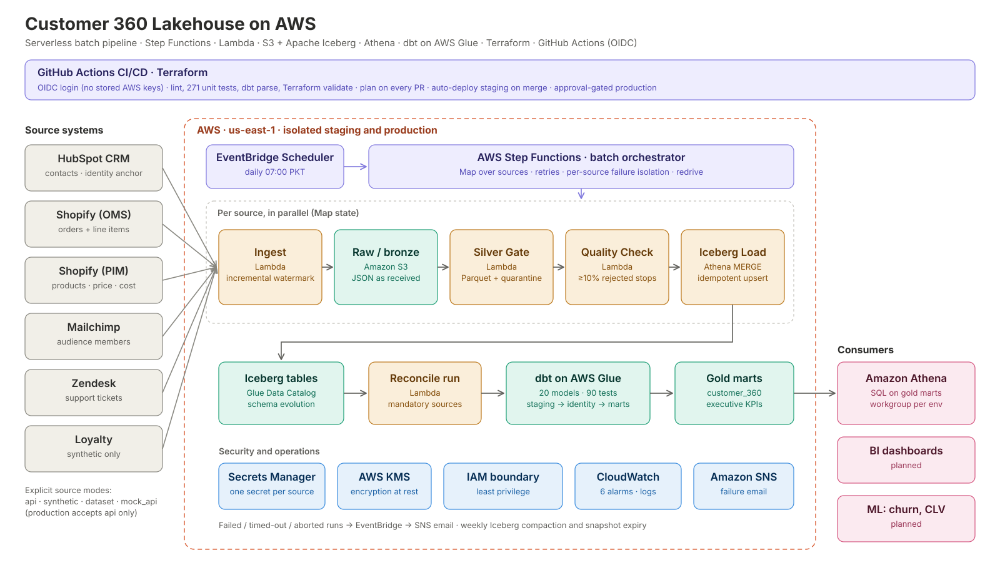

# 🧩 Customer 360 Lakehouse on AWS

<p align="center">
  <a href="https://github.com/Muhammad-Saad12345/Customer_360-Production-ready-Data-Pipeline/actions/workflows/ci.yml"></a>
  
  
  
  
  
  
  
  
</p>

---

## 📖 Overview

**Customer 360** is a serverless, production-style data platform on AWS that unifies customer data from CRM, orders, products, marketing, support and loyalty systems into **one trusted customer profile**.

Each source is ingested incrementally, validated by a quality gate, written to **Apache Iceberg** tables with idempotent `MERGE`, matched to a single customer identity, and modelled with **dbt** into analytics-ready marts queried through **Amazon Athena**. The whole platform is defined in **Terraform** and delivered by **GitHub Actions** with OIDC: no AWS keys are stored anywhere, every change is planned on a pull request, staging deploys on merge, and production requires approval.

---

## 🎯 Business Problem

Customer information lives in separate systems: the CRM knows contact details, the order system knows purchases, the marketing platform knows email engagement, and support knows complaints. No single system has the full picture, which leads to:

- duplicate customer records and no common customer ID
- KPIs that disagree between teams and reports
- generic marketing and poor personalisation
- slow, manual reporting
- no trusted foundation for churn, CLV or recommendation models

**Goal:** one customer, one profile, one source of truth, refreshed automatically and tested on every run.

---

## 🏗 Architecture



---

## ✨ Key Features

- **Multi-source ingestion:** 6 connectors (HubSpot CRM, Shopify orders, Shopify products, Mailchimp, Zendesk, loyalty) with incremental watermarks per source.
- **Explicit source modes:** every source runs as `api`, `synthetic`, `dataset` or `mock_api`, and every record is tagged with its mode. No silent fallback to fake data; production accepts `api` only.
- **Quality gate with quarantine:** schema, primary key, duplicate, email and timestamp checks. Rejected records are quarantined with a reason; a source with ≥ 10% rejections is stopped before it reaches the lakehouse.
- **Idempotent Iceberg lakehouse:** Athena `MERGE` on primary keys, so retries never duplicate rows. Columns added in code are added to live tables automatically (schema evolution).
- **Identity resolution:** every order, ticket and marketing record is linked to a HubSpot contact by CRM ID, then exact email, then phone. Unmatched records stay visible as exceptions.
- **Customer 360 data model:** 20 dbt models from staging to identity, facts and dimensions, and marts (`customer_360`, `mart_customer_metrics`, `mart_executive_kpis`, `fct_kpi_daily`).
- **Trusted numbers:** 83 dbt schema tests and 7 singular tests, including a reconciliation test that requires revenue to match across `fact_order`, `customer_360` and the executive KPIs.
- **Resilient orchestration:** Step Functions processes sources in parallel; one failing source does not stop the others, and failed runs can be redriven from the failed step.
- **Alerting and monitoring:** failed, timed-out or aborted runs send an email through EventBridge and SNS; 6 CloudWatch alarms; a scheduled daily AWS health check.
- **Secure by default:** GitHub OIDC (no stored keys), one Secrets Manager secret per source readable only by the ingest function, KMS encryption, and a permission boundary on every workload role.

---

## 🚀 Tech Stack

| Category | Technology | Why this choice |
| :--- | :--- | :--- |
| **💻 Language** | Python 3.11, SQL, Jinja | Lambda runtime, dbt models |
| **⚙️ Orchestration** | AWS Step Functions, EventBridge Scheduler | Pay per run instead of an always-on Airflow (MWAA) environment; built-in retries, parallel Map state and redrive |
| **🧮 Compute** | AWS Lambda | Small per-run volumes, instant start, nothing to manage |
| **🗄 Storage** | Amazon S3, Apache Iceberg | Open table format with ACID `MERGE`, schema evolution and time travel |
| **🔎 Query engine** | Amazon Athena (engine v3) | Serverless SQL, pay per query, no idle cluster |
| **🔄 Transformation** | dbt Core 1.8 + dbt-athena, run on AWS Glue | Version-controlled, tested models with lineage; Glue runs dbt without a server |
| **📚 Catalog** | AWS Glue Data Catalog | Single catalog for Iceberg tables and dbt models |
| **🔐 Security** | IAM permission boundary, Secrets Manager, KMS | Least privilege per function, per-source credentials, encryption at rest |
| **📈 Observability** | CloudWatch, SNS, EventBridge rules | Alarms, logs and failure emails |
| **🏗 Infrastructure as Code** | Terraform | Reproducible staging and production; plan before every change |
| **🔁 CI/CD** | GitHub Actions + OIDC | Tests, Terraform plan on PRs, auto-deploy to staging, approval-gated production |
| **🧪 Testing** | pytest, moto, ruff, bandit, gitleaks | Unit and contract tests, lint, security scan, secret scan |

---

## 🔄 Pipeline Workflow

```text
EventBridge schedule / manual start
        │
        ▼
InitializePipeline ──► ProcessSources (Map, one branch per source, in parallel)
                          Ingest ──► SilverGate ──► QualityCheck ──► IcebergLoad
        │
        ▼
ReconcileRun (mandatory sources loaded?) ──► dbt run ──► dbt test ──► PipelineSucceeded
        │
        └── on failure: EventBridge ──► SNS email · redrive from the failed step
```

### 📊 Data Layers

| Layer | Location | What happens |
| :--- | :--- | :--- |
| 🥉 **Raw (bronze)** | `s3://…/raw/<source>/…` | Records exactly as received, tagged with run ID and source mode |
| 🥈 **Silver** | `s3://…/silver/<source>/<entity>/…` | Validated Parquet; rejected records quarantined with a reason |
| 🧊 **Iceberg** | Glue database, one table per source | Idempotent `MERGE` on primary keys |
| 🥇 **Gold** | dbt marts in Athena | Identity bridge, facts, dimensions, `customer_360`, KPIs |

---

## 🔁 CI/CD and Environments

| Trigger | What runs |
| :--- | :--- |
| Pull request | Lint, 271 unit tests, bandit, gitleaks, Step Functions ASL validation, `dbt parse`, Terraform validate, **Terraform plan for staging and production** (posted as a PR notice) |
| Merge to `main` | Package Lambda, Glue and dbt artifacts → `terraform apply` to **staging** → dry-run smoke test → resource health check |
| Manual dispatch (`prod`) | Same pipeline for **production**, after an approval in the `production` environment |
| Daily | AWS health check of the deployed environment |

Staging and production are fully isolated: separate state, buckets, Glue databases, Athena workgroups, roles and secrets.

---

## 📂 Project Structure

```text
.
├── .github/workflows/          # CI/CD (ci.yml) and daily AWS health check (aws-verify.yml)
├── docs/images/                # Architecture diagram
└── customer360/
    ├── src/
    │   ├── ingestion/          # Source connectors, source modes, HTTP client
    │   ├── processing/         # Silver quality gate
    │   ├── lakehouse/          # Iceberg table definitions, loader, maintenance
    │   └── contracts/          # Data contracts
    ├── lambda_handlers/        # 8 Lambda functions (one per pipeline step)
    ├── step_functions/         # State machine definition (ASL)
    ├── glue_jobs/              # dbt runner for AWS Glue
    ├── dbt/                    # 20 models: staging, identity, facts, dimensions, marts + tests
    ├── terraform/
    │   ├── bootstrap/          # State buckets, CI roles, permission boundary (one-time)
    │   ├── modules/            # core, lambda, glue_jobs, step_functions, eventbridge
    │   └── environments/       # staging, prod
    ├── scripts/                # aws_doctor.sh, validate_run.py, smoke_dry_run.sh, packaging
    ├── tests/                  # 271 pytest tests
    └── docs/                   # Setup guide, runbook, permissions, rollback, audit
```

---

## 📦 Getting Started

### 1️⃣ Run the tests locally

```bash
git clone https://github.com/Muhammad-Saad12345/Customer_360-Production-ready-Data-Pipeline.git
cd Customer_360-Production-ready-Data-Pipeline/customer360
pip install -r requirements-dev.txt
python -m pytest -q
```

### 2️⃣ Deploy to your AWS account

1. Follow [`MANUAL_AWS_SETUP_GUIDE.md`](customer360/docs/MANUAL_AWS_SETUP_GUIDE.md): create an admin user with MFA and apply `terraform/bootstrap` once.
2. In GitHub, create the `staging` and `production` environments and set `AWS_REGION`, `AWS_PLAN_ROLE_ARN`, `ALERT_EMAIL` and `AWS_DEPLOY_ROLE_ARN`.
3. Merge to `main`: CI deploys staging. Start production from **Actions → Run workflow → prod**.

### 3️⃣ Run the pipeline

AWS Console → **Step Functions** → `c360-staging-batch-orchestrator` → **Start execution** with input `{}` (all sources), `{"dry_run": true}` or `{"sources": ["hubspot", "oms"]}`. Validate the run with `scripts/validate_run.py` or the Athena checks in the [runbook](customer360/docs/PRODUCTION_DEPLOYMENT_RUNBOOK.md).

---

## 📊 Project Status

| Component | Status |
| :--- | :---: |
| Terraform bootstrap (state, CI roles, permission boundary) | ✅ |
| CI/CD with OIDC, PR plans, approval-gated production | ✅ |
| Staging environment deployed and health-checked | ✅ |
| Alerting (failure email verified) | ✅ |
| End-to-end staging run on synthetic data | 🔄 In validation |
| Real source APIs (HubSpot, Shopify) | 🚧 Next |
| Production deployment | 🚧 Planned |
| BI dashboards | 🚧 Planned |

---

## 🛠 Engineering Highlights

- **Zero stored credentials:** CI authenticates to AWS with GitHub OIDC; trust policies are pinned to this repository and to each GitHub environment.
- **Least privilege:** replaced a legacy CI role that had six AWS-managed `*FullAccess` policies with scoped plan and deploy roles under a permission boundary.
- **Fast, safe delivery:** a merged change is packaged, deployed to staging and verified in about **2 minutes**; production changes are planned on the PR and require approval.
- **Reproducible infrastructure:** staging (56 resources) and production (66 resources) are built entirely from Terraform.
- **Caught before production:** the staged rollout surfaced 7 real defects, each fixed with a regression test:
  - CI hid failed `terraform plan` runs
  - plan-time `count` on values only known after apply
  - GitHub's new immutable OIDC subject format
  - non-ingest functions reading Secrets Manager
  - a missing read permission for plan refresh
  - a misleading "destroy" in PR plans
  - schema drift between code and live Iceberg tables

---

## 📈 Future Improvements

- 🔹 Real-time path: Shopify webhooks through EventBridge, Kinesis Data Streams and Firehose into Iceberg
- 🔹 Clickstream ingestion for the web journey
- 🔹 BI dashboards on the gold marts (QuickSight or Looker Studio)
- 🔹 Churn prediction and CLV models on `customer_360`
- 🔹 PII governance: column masking and retention rules
- 🔹 Zendesk OAuth (client credentials) connector

---

## 👨‍💻 Author

**Muhammad Saad**
*Data Engineer | AWS | dbt | Airflow | Python | SQL*

- GitHub: [Muhammad-Saad12345](https://github.com/Muhammad-Saad12345)
- LinkedIn: [saad-yaqoob-05244726b](https://www.linkedin.com/in/saad-yaqoob-05244726b/)
- 🚀 Open to Data Engineering roles

---

### ⭐ Support

If you found this project useful, please consider giving it a **star** ⭐.
