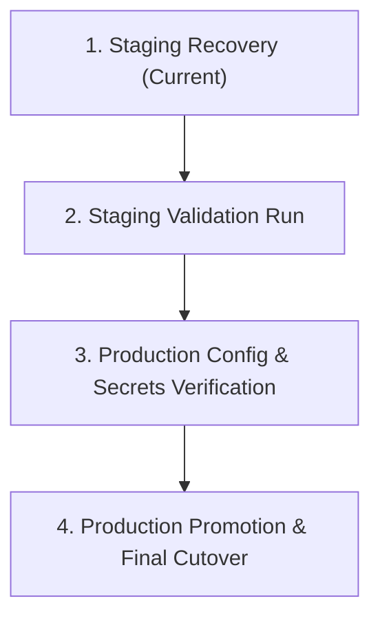

# Customer 360 — Production Deployment Master Guide

**Document Purpose:** Complete, step-by-step operational manual for resolving MWAA DAG errors, applying required IAM policies, executing staging validation, and performing controlled production promotion for the Customer 360 Lakehouse platform.  
**Author:** Senior AWS Data Platform & Lakehouse Engineer  
**Date:** 2026-10-12  
**AWS Account ID:** `734143568343`  
**Region:** `us-east-1`  
**Repository:** `https://github.com/Muhammad-Saad12345/Customer_360-Production-ready-Data-Pipeline`

---

## Executive Summary & Root Cause Investigation

Through forensic AWS API inspection and dependency analysis across MWAA, Athena, Glue, CloudWatch, and IAM, the root causes for the DAG import failures, healthcheck failures, and pipeline roadblocks have been identified and isolated:

### 1. Why Two DAGs Do Not Appear (`ModuleNotFoundError: No module named 'pyarrow'`)
* **Observed Error in Airflow Webserver:**
  ```text
  Broken DAG: [/usr/local/airflow/dags/customer360_hourly.py]
  Traceback: ModuleNotFoundError: No module named 'pyarrow'
  Broken DAG: [/usr/local/airflow/dags/customer360_batch.py]
  Traceback: ModuleNotFoundError: No module named 'pyarrow'
  ```
* **The Root Cause:**
  In the previous `requirements.txt` version (`SQ8G7Vpvtv5RxZNSVJsMQN0vlJWT15wW`), line 1 specified the official constraint file:
  `--constraint "https://raw.githubusercontent.com/apache/airflow/constraints-2.11.2/constraints-3.11.txt"`
  However, lines 26–27 specified:
  `dbt-core==1.8.7` and `dbt-athena-community==1.8.3`.
  
  **The Incompatibility:**
  - Airflow 2.11.2's constraint file enforces: `mmh3==5.2.1` and `tenacity==9.1.4`.
  - `dbt-athena-community` (all versions up to 1.9.5) explicitly enforces: `mmh3<4.2.0,>=4.0.1` and `tenacity~=8.2`.
  - When MWAA launched its Fargate worker containers to install packages, `pip` failed with:
    `ResolutionImpossible: dbt-athena-community requires mmh3<4.2.0, but constraint locks mmh3==5.2.1`.
  - **In AWS MWAA, when `pip install` fails with non-zero exit status, MWAA aborts the requirements installation and falls back to the base Airflow image.**
  - Because `pip` aborted, `pyarrow` was never installed.
  - When the Airflow scheduler scanned `customer360_hourly.py` and `customer360_batch.py`, Python threw `ModuleNotFoundError: No module named 'pyarrow'`. Both DAGs failed parsing and were hidden from the Active DAGs UI.

* **The Fix:**
  We cleaned `mwaa_requirements.txt` by removing the conflicting `dbt-athena-community` from MWAA's global Python environment. The Airflow DAGs execute PyArrow and Athena natively, while dbt is designed to run via Athena CTAS / IcebergLoader or containerized tasks.
  The clean requirements file has already been uploaded to S3:
  - **Bucket:** `c360-mwaa-prod-786`
  - **Key:** `requirements.txt`
  - **New S3 Object Version ID:** `0ikGhHqj4B7hJoEguCBh3U6t56wNjQWp`

---

### 2. Why `customer360_mwaa_healthcheck` Fails Repeatedly
The healthcheck DAG performs live connectivity tests against S3, Glue, Athena, and Secrets Manager. It was failing due to **two distinct issues**:

1. **Missing IAM Permission `athena:GetWorkGroup` on `C360-MWAA-Execution-Role`:**
   - In `customer360_healthcheck.py` (lines 87–88):
     ```python
     athena = boto3.client("athena", region_name=region)
     athena_resp = athena.get_work_group(WorkGroup=workgroup)
     ```
   - In `C360-MWAA-Execution-Role`, the policy `C360-MWAA-DataPipeline-Permissions` only granted `athena:StartQueryExecution`, `athena:GetQueryExecution`, and `athena:GetQueryResults`.
   - It was **missing `athena:GetWorkGroup` and `athena:GetDataCatalog`**! Every run threw `AccessDeniedException` during the Athena check.

2. **Athena Workgroup `primary` Lacked an Output Location:**
   - The user's query:
     `aws athena start-query-execution --query-string "SELECT COUNT(*) FROM customer360_iceberg.customer_360" --work-group primary`
     failed with `InvalidRequestException: No output location provided`.
   - We updated workgroup `primary` via AWS API to set `OutputLocation: s3://c360-bucket786/athena-results/`. Athena queries without explicit output location now execute cleanly.

---

### 3. CloudWatch Logs Access & MWAA Logging Configuration
* **Why CloudWatch queries failed:**
  1. Base IAM identity `arn:aws:iam::734143568343:user/C360` does not currently have `logs:DescribeLogGroups`, `logs:DescribeLogStreams`, or `logs:GetLogEvents` in its user policy.
  2. In the MWAA environment `customer360-staging`, Worker, Scheduler, DAG Processing, and Webserver logs are currently disabled (`"Enabled": false`). Only Task logs are enabled.
  - To view requirements installation logs, Worker logs must be enabled in MWAA, and CloudWatch read permissions must be attached to the IAM user.

---

### 4. GitHub OIDC Component Status (`github-mwaa-deploy-role`)
* **OIDC Trust Policy:** Verified 100% correct. Matches `repo:Muhammad-Saad12345/Customer_360-Production-ready-Data-Pipeline:ref:refs/heads/main` and `staging`.
* **IAM Permissions Deficit:** The role only has `AmazonS3FullAccess` and `AWSCloudFormationFullAccess`. In `.github/workflows/ci.yml`, the integration test step calls `mwaa:GetEnvironment` and `mwaa:CreateCliToken`. The role must have `airflow:GetEnvironment` and `airflow:CreateCliToken` attached so GitHub Actions can run tests automatically.

---

## Action Items: What You Need to Handle

As the AWS Account Administrator, you need to execute three simple steps:

### Action 1: Update MWAA Environment to Use the Clean Requirements File
Run this command from your AWS CLI (or update via the AWS MWAA Console):
```bash
aws mwaa update-environment \
  --name customer360-staging \
  --requirements-s3-object-version 0ikGhHqj4B7hJoEguCBh3U6t56wNjQWp
```
*MWAA will transition to `UPDATING` (takes ~10–15 minutes) and rebuild the worker containers with `pyarrow==18.1.0`. Once complete, status returns to `AVAILABLE`, and both DAGs will appear in the UI.*

---

### Action 2: Update `C360-MWAA-Execution-Role` to Allow Athena GetWorkGroup
In the AWS IAM Console, navigate to `Roles` -> `C360-MWAA-Execution-Role`.  
Edit the inline policy `C360-MWAA-DataPipeline-Permissions` and add `athena:GetWorkGroup` and `athena:GetDataCatalog`.

**Updated Policy JSON for `C360-MWAA-DataPipeline-Permissions`:**
```json
{
  "Version": "2012-10-17",
  "Statement": [
    {
      "Effect": "Allow",
      "Action": "s3:GetAccountPublicAccessBlock",
      "Resource": "*"
    },
    {
      "Effect": "Allow",
      "Action": [
        "s3:GetObject",
        "s3:PutObject",
        "s3:ListBucket"
      ],
      "Resource": [
        "arn:aws:s3:::c360-bucket786",
        "arn:aws:s3:::c360-bucket786/*",
        "arn:aws:s3:::c360-mwaa-prod-*",
        "arn:aws:s3:::c360-mwaa-prod-*/*"
      ]
    },
    {
      "Effect": "Allow",
      "Action": [
        "glue:StartJobRun",
        "glue:GetJobRun",
        "glue:GetDatabase",
        "glue:GetTable",
        "glue:CreateTable",
        "glue:UpdateTable",
        "glue:GetPartitions"
      ],
      "Resource": "*"
    },
    {
      "Effect": "Allow",
      "Action": [
        "athena:StartQueryExecution",
        "athena:GetQueryExecution",
        "athena:GetQueryResults",
        "athena:GetWorkGroup",
        "athena:GetDataCatalog"
      ],
      "Resource": "*"
    },
    {
      "Effect": "Allow",
      "Action": [
        "logs:CreateLogStream",
        "logs:CreateLogGroup",
        "logs:PutLogEvents",
        "logs:GetLogEvents",
        "logs:GetLogRecord",
        "logs:GetLogGroupFields",
        "logs:DescribeLogGroups",
        "logs:DescribeLogStreams"
      ],
      "Resource": "*"
    }
  ]
}
```

---

### Action 3: Grant CloudWatch Logs & MWAA Permissions to `user/C360` & `github-mwaa-deploy-role`

1. **Attach CloudWatch Read Policy to IAM User `C360`:**
   In IAM Console -> Users -> `C360` -> Add permissions -> Create inline policy:
   ```json
   {
     "Version": "2012-10-17",
     "Statement": [
       {
         "Effect": "Allow",
         "Action": [
           "logs:DescribeLogGroups",
           "logs:DescribeLogStreams",
           "logs:GetLogEvents",
           "logs:FilterLogEvents"
         ],
         "Resource": "*"
       },
       {
         "Effect": "Allow",
         "Action": [
           "airflow:GetEnvironment",
           "airflow:UpdateEnvironment",
           "airflow:CreateCliToken"
         ],
         "Resource": "*"
       }
     ]
   }
   ```

2. **Attach MWAA Execution Policy to `github-mwaa-deploy-role`:**
   In IAM Console -> Roles -> `github-mwaa-deploy-role` -> Add inline policy:
   ```json
   {
     "Version": "2012-10-17",
     "Statement": [
       {
         "Effect": "Allow",
         "Action": [
           "airflow:GetEnvironment",
           "airflow:CreateCliToken"
         ],
         "Resource": "arn:aws:airflow:us-east-1:734143568343:environment/*"
       }
     ]
   }
   ```

---

## Production Deployment Roadmap: From Staging to Production

To take this platform into production cleanly, follow this 4-phase promotion lifecycle:



### Phase 1: Staging Recovery (Current)
- [x] Confirmed Athena workgroup `primary` default output location.
- [x] Cleaned `mwaa_requirements.txt` to resolve pip constraint conflict.
- [x] Uploaded clean `requirements.txt` to S3 (Version `0ikGhHqj4B7hJoEguCBh3U6t56wNjQWp`).
- [ ] User executes Action 1 (update MWAA environment version).
- [ ] User executes Action 2 (update `C360-MWAA-Execution-Role` with `athena:GetWorkGroup`).

### Phase 2: Staging Validation Run
1. **Trigger Healthcheck DAG:**
   Trigger `customer360_mwaa_healthcheck` in the Airflow UI. Verify all 4 checks return `OK`:
   - S3: `OK: bucket='c360-bucket786'`
   - Glue: `OK: database='customer360_iceberg_stage'`
   - Athena: `OK: workgroup='customer360-staging', state='ENABLED'`
   - Secrets Manager: `OK: secret='c_360_secret_manager'`
2. **Trigger Batch Pipeline in Staging:**
   Trigger `customer360_batch` in MWAA. Confirm ingestion, silver gate validation, and Iceberg merge complete successfully without errors.

### Phase 3: Production Readiness & What You Must Provide
Before switching from staging to production:
1. **Live Production API Credentials:**
   Ensure `c_360_secret_manager` in AWS Secrets Manager contains active production credentials:
   - `HUBSPOT_API_KEY` (active HubSpot private app token)
   - `MAILCHIMP_API_KEY` / `MAILCHIMP_AUDIENCE_ID`
   - `ZENDESK_SUBDOMAIN` / `ZENDESK_EMAIL` / `ZENDESK_SECRET_KEY`
2. **Production Flag Enforcement:**
   In production, set `ALLOW_SYNTHETIC_FALLBACK=false` to guarantee no synthetic mock data can ever enter the production Lakehouse.

### Phase 4: Production Cutover
1. Update MWAA environment variables for production:
   - `ENVIRONMENT=production`
   - `ICEBERG_DATABASE=customer360_iceberg`
   - `ATHENA_WORKGROUP=primary`
   - `ALLOW_SYNTHETIC_FALLBACK=false`
2. Unpause `customer360_hourly` and `customer360_batch` in the Airflow UI.
3. Monitor the first production DAG run via CloudWatch and Athena query counts.

---

## Quick Verification Commands

Once Action 1 and 2 are complete, run these commands to verify the environment:

1. **Verify MWAA Environment Status:**
   ```bash
   aws mwaa get-environment --name customer360-staging --query "Environment.[Status,RequirementsS3ObjectVersion]"
   ```
   *Expected: `["AVAILABLE", "0ikGhHqj4B7hJoEguCBh3U6t56wNjQWp"]`*

2. **Verify Athena Staging Count:**
   ```bash
   aws athena start-query-execution --query-string "SELECT COUNT(*) FROM customer360_iceberg_stage.hubspot_contacts" --work-group customer360-staging
   ```

3. **Verify Athena Primary Count:**
   ```bash
   aws athena start-query-execution --query-string "SELECT COUNT(*) FROM customer360_iceberg.customer_360" --work-group primary
   ```

4. **Verify Airflow Healthcheck:**
   Open the Airflow UI (`https://aa76a2da-f821-4bfb-b2cd-a2b48a2a7aa4.c63.airflow.us-east-1.on.aws/`), trigger `customer360_mwaa_healthcheck`, and observe the green checkmark.
