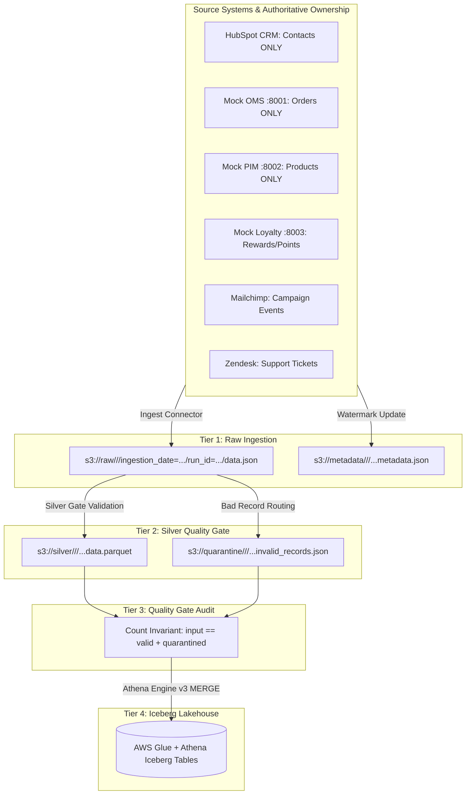

# Customer 360 Airflow Architecture & Orchestration Guide

## 1. Executive Summary & Purpose

The Customer 360 Airflow orchestration layer serves as the unified batch scheduler and execution engine for multi-source data ingestion, schema validation, data quality (DQ) gating, and lakehouse tiering into AWS S3 and Apache Iceberg.

The architecture strictly decouples **orchestration** from **data processing**:
- **Airflow** manages scheduling, dependencies, task execution state, retries, and operational observability.
- **Python / PyArrow / Pydantic** engine owns connector business logic, watermark checkpoints, schema enforcement, DQ rules, and format conversion.
- **AWS S3** serves as the immutable storage substrate partitioned across Raw, Silver, Quarantine, and Metadata tiers.
- **AWS Glue Data Catalog & Amazon Athena Engine v3** manage the Apache Iceberg ACID lakehouse layer.



---

## 2. Authoritative Source Ownership Rules

To eliminate split-brain data conflicts and maintain data provenance integrity across the enterprise, the pipeline strictly enforces source ownership:

| Domain Entity | Authoritative Source System | Disallowed / Prohibited Sources | Enforcement Layer |
| :--- | :--- | :--- | :--- |
| **Contacts / Customers** | **HubSpot CRM** | OMS, PIM | `HubSpotIngest.object_name = "contacts"`; no order/product extraction methods. |
| **Orders / Transactions** | **OMS (Order Management)** | HubSpot CRM | `OmsIngest`; Silver contract `("oms", "orders")`; Iceberg table `oms_orders`. |
| **Product Catalog** | **PIM** | HubSpot CRM | `PimIngest`; Silver contract `("pim", "products")`; Iceberg table `pim_products`. |
| **Loyalty & Rewards** | **Loyalty Engine** | HubSpot CRM | `LoyaltyIngest`; Silver contract `("loyalty", "loyalty")`; Iceberg table `loyalty_loyalty`. |
| **Campaign Events** | **Marketing (Mailchimp)** | HubSpot CRM | `MarketingIngest`; Silver contract `("marketing", "campaign_events")`. |
| **Support Tickets** | **Zendesk** | HubSpot CRM | `ZendeskIngest`; Silver contract `("support", "tickets")`. |

> [!IMPORTANT]
> HubSpot is **CONTACTS ONLY**. Any attempt to ingest orders or products through HubSpot is rejected and quarantined by the Silver Quality Gate.

---

## 3. Orchestration Stack Topology

The local execution stack is deployed via Docker Compose with three interconnected services:

1. **`postgres:15`**:
   - Stores Airflow metadata, DAG definitions, DAG run records, and XCom payloads.
   - Built-in healthcheck (`pg_isready -U airflow`) ensures Airflow services wait until the database is ready.

2. **`airflow-webserver`**:
   - Exposes port `8080` for UI monitoring, DAG inspection, task log analysis, and manual triggers.
   - Executes `airflow db init` and creates the default `admin` account on initial container launch.
   - Configured with `restart: on-failure`.

3. **`airflow-scheduler`**:
   - Continuous daemon running `LocalExecutor`.
   - Polls `/opt/airflow/dags` for DAG updates and schedules task executions concurrently across CPU worker threads.
   - Communicates with host-bound mock services via `host.docker.internal:host-gateway`.

### Container Networking & Host Integration

To support both containerized operations and local mock microservices, Docker Compose configures host gateway routing:

```yaml
extra_hosts:
  - "host.docker.internal:host-gateway"
environment:
  AIRFLOW_HOME: /opt/airflow
  AIRFLOW__CORE__DAGS_FOLDER: /opt/airflow/dags
  OMS_BASE_URL: http://host.docker.internal:8001
  PIM_BASE_URL: http://host.docker.internal:8002
  LOYALTY_BASE_URL: http://host.docker.internal:8003
```

---

## 4. Unified 4-Tier Pipeline Architecture

The authoritative production DAG is `customer360_hourly_ingestion` (`dags/customer360_hourly.py`), implementing a complete 4-tier lakehouse lifecycle with zero stranded raw data:

```text
customer360_hourly_ingestion
  │
  ├── Tier 1: ingest_hubspot (Incremental extraction -> S3 Raw)
  │     │
  │     ▼
  ├── Tier 2: validate_and_write_silver_hubspot (Contract validation -> S3 Silver Parquet + Quarantine)
  │     │
  │     ▼
  ├── Tier 3: quality_check_hubspot (Reconciliation audit: input == valid + invalid)
  │     │
  │     ▼
  └── Tier 4: load_iceberg_hubspot (Athena Engine v3 MERGE INTO Iceberg table)
```

### Task Responsibility Breakdown

1. **Tier 1 — Ingestion Task (`ingest_*`)**:
   - Reads current watermark timestamp from `.checkpoints/<source>_<entity>.json` or S3 metadata.
   - Queries source API using incremental filtering with configured lookback window.
   - Writes raw payload to S3: `raw/<source>/<entity>/ingestion_date={YYYY-MM-DD}/run_id={UUID}/data.json`.
   - Writes extraction metadata to S3 and advances the checkpoint watermark.
   - Configured with `retries=2, retry_delay=5m` and `execution_timeout=30m`.

2. **Tier 2 — Silver Gate Task (`validate_and_write_silver_*`)**:
   - Triggered only after successful ingestion.
   - Fetches raw JSON payload from S3.
   - Validates each record against machine-readable `DataContractRegistry` (`src/contracts/data_contracts.py`):
     - Schema structure & field types
     - Required business primary keys and valid email formats
     - Numeric range constraints (e.g., non-negative amounts, prices, points)
     - Enum validity (order status, channel, priority)
   - Segregates records:
     - Valid records -> Snappy-compressed Parquet in `silver/<source>/<entity>/ingestion_date=.../run_id=.../data.parquet`.
     - Invalid records -> JSON quarantine in `quarantine/<source>/<entity>/ingestion_date=.../run_id=.../invalid_records.json` with rule failure reasons.

3. **Tier 3 — Quality Check Task (`quality_check_*`)**:
   - Strictly enforces the count reconciliation invariant:
     $$\text{input\_records} = \text{valid\_records} + \text{quarantined\_records}$$
   - Fails the task and prevents lakehouse promotion if record loss or unaccounted drift is detected.

4. **Tier 4 — Iceberg Lakehouse Loader (`load_iceberg_*`)**:
   - Reads validated Silver Parquet from S3.
   - Performs intra-batch deduplication on primary keys (preserving latest timestamp).
   - Detects schema evolution against live AWS Glue Data Catalog and applies `ALTER TABLE ADD COLUMNS`.
   - Executes atomic Athena Engine v3 `MERGE INTO` statement with inline `VALUES` staging.
   - Verifies row count and ensures strict zero-duplicate idempotency on re-runs.

---

## 5. Storage Layout & Partitioning Strategy

S3 objects in bucket `c360-bucket786` follow Hive-compatible partition paths:

```text
c360-bucket786/
├── raw/
│   └── {source}/{entity}/ingestion_date={YYYY-MM-DD}/run_id={UUID}/data.json
├── silver/
│   └── {source}/{entity}/ingestion_date={YYYY-MM-DD}/run_id={UUID}/data.parquet
├── quarantine/
│   └── {source}/{entity}/ingestion_date={YYYY-MM-DD}/run_id={UUID}/invalid_records.json
├── metadata/
│   └── {source}/{entity}/ingestion_date={YYYY-MM-DD}/run_id={UUID}/metadata.json
└── iceberg/
    └── {table_name}/
        ├── metadata/ (Iceberg metadata.json, manifest lists, manifest files)
        └── data/     (Iceberg snappy parquet data files)
```

- **Partition Key (`ingestion_date`)**: Enables partition pruning for date-bounded incremental processing and analytics queries.
- **Run Isolation (`run_id`)**: Provides strict run-level isolation, preventing concurrency conflicts and ensuring zero-overwrite idempotency.

---

## 6. How to Run the Project

### Option A: Local CLI Execution (Recommended for Fast Validation)

1. **Start the local mock source API servers** (OMS, PIM, Loyalty):
   ```bash
   uv run python scripts/start_mock_sources.py
   ```
   *Runs OMS on port 8001, PIM on port 8002, Loyalty on port 8003.*

2. **Verify AWS Connectivity**:
   ```bash
   uv run python src/main.py validate
   ```

3. **Ingest individual source systems**:
   ```bash
   uv run python src/main.py hubspot     # HubSpot contacts ONLY
   uv run python src/main.py oms         # OMS orders
   uv run python src/main.py pim         # PIM products
   uv run python src/main.py loyalty     # Loyalty rewards
   uv run python src/main.py marketing   # Marketing campaign events
   uv run python src/main.py support     # Zendesk tickets
   ```
   Or run all sources in sequence:
   ```bash
   uv run python src/main.py all-sources
   ```

4. **Run the Silver Quality Gate**:
   ```bash
   uv run python src/main.py silver-gate
   ```

5. **Load into Apache Iceberg Tables**:
   ```bash
   # Dry-run validation (checks schema, dedup, and DDL without mutating tables)
   uv run python src/main.py iceberg-load --dry-run

   # Production load via Athena Engine v3 MERGE
   uv run python src/main.py iceberg-load
   ```

6. **Run Full Test Suite**:
   ```bash
   uv run pytest
   ```

### Option B: Docker Compose Airflow Cluster

1. **Launch Airflow**:
   ```bash
   docker compose up -d
   ```
2. **Access Web UI**:
   Navigate to `http://localhost:8080` (Username: `admin`, Password: `admin`).
3. **Trigger DAG**:
   Unpause and trigger `customer360_hourly_ingestion`.

---

## 7. Migration Path to AWS Managed Workflows for Apache Airflow (MWAA)

When migrating from local Docker Compose to production AWS MWAA:
1. **DAGs and Plugins**: Sync `dags/` and `src/` to the MWAA S3 environment bucket.
2. **Requirements**: Provide `requirements.txt` containing `pyarrow>=14.0.0`, `boto3`, `pydantic`.
3. **IAM Execution Role**: Attach IAM policies granting read/write access to `arn:aws:s3:::c360-bucket786/*`, AWS Glue, and Athena.
4. **Secrets Management**: Replace local `.env` with AWS Secrets Manager backend (`airflow.providers.amazon.aws.secrets.secrets_manager.SecretsManagerBackend`).
5. **VPC Networking**: Connect MWAA private subnets to external SaaS sources via NAT Gateway and to internal microservices via VPC Endpoints / PrivateLink.
