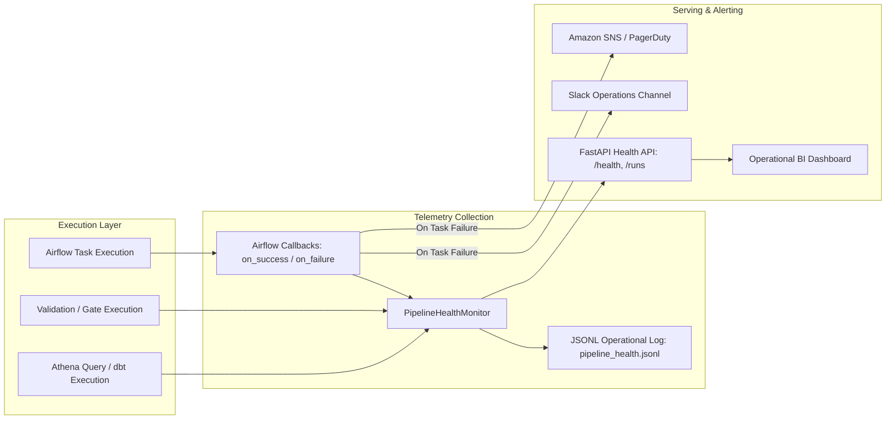

# Customer 360 Lakehouse — Observability & Alerting Architecture

This guide details the operational monitoring, telemetry, alerting triggers, SLA metrics, and cost observability mechanisms for the Customer 360 platform.

---

## 1. Observability Architecture Overview

The platform implements multi-layered telemetry spanning Airflow task execution, data contract validation gates, Athena query execution, and a centralized FastAPI health service.



---

## 2. SLA & Freshness Thresholds

| Pipeline / Entity | Execution Cadence | Max Expected Duration | SLA Freshness Threshold | Alert Severity on Breach |
| :--- | :--- | :--- | :--- | :--- |
| **HubSpot Contacts (Hourly)** | Hourly (`0 * * * *`) | 10 minutes | 2 hours | **High (P2)** |
| **Batch Pipeline (All Sources)**| Daily / Ad-hoc | 45 minutes | 26 hours | **High (P2)** |
| **OMS Orders** | Daily Batch | 15 minutes | 24 hours | **Critical (P1)** |
| **PIM Products** | Daily Batch | 10 minutes | 24 hours | **Medium (P3)** |
| **Loyalty Activity** | Daily Batch | 10 minutes | 24 hours | **Medium (P3)** |
| **Campaign Events** | Daily Batch | 15 minutes | 24 hours | **Low (P4)** |
| **Zendesk Tickets** | Daily Batch | 15 minutes | 24 hours | **Medium (P3)** |
| **dbt Transformations** | Post-Ingest | 20 minutes | 26 hours | **High (P2)** |
| **Iceberg Compaction** | Post-dbt | 15 minutes | 7 days | **Low (P4)** |

---

## 3. Data Quality & Quarantine Alert Thresholds

The `PipelineHealthMonitor` automatically computes the **rejection rate** (`invalid_count / input_count`) for each source during contract validation:

| Health Tier | Rejection Rate Threshold | System Action | Notification Channel |
| :--- | :--- | :--- | :--- |
| **HEALTHY (OK)** | `< 2.0%` | Processing continues normally. | Telemetry logged to JSONL. |
| **DEGRADED (WARNING)** | `2.0% - 10.0%` | Processing continues; quarantined records flagged. | Slack `#data-ops-warnings`. |
| **CRITICAL (ERROR)** | `> 10.0%` | Task fails or triggers escalation. Stewards notified. | PagerDuty / Slack `#data-ops-critical`. |
| **ZERO-RECORD ANOMALY** | `0 records` (where historical avg > 100) | Warning triggered: potential source API failure or upstream outage. | Slack `#data-ops-warnings`. |

---

## 4. Pipeline Health API Endpoints

The FastAPI monitoring microservice runs alongside the lakehouse and exposes standardized health telemetry:

### Endpoints Reference

#### `GET /health`
Returns quick binary health check suitable for Kubernetes probes or load balancer health checks.
```json
{
  "status": "ok",
  "generated_at": "2026-09-30T16:20:00Z",
  "total_runs_tracked": 142,
  "sources_active": 6,
  "error_count": 0,
  "warning_count": 0
}
```

#### `GET /health/detail`
Returns full breakdown including recent run metrics, average latencies, rejection rates per source, and explicit warning/error diagnostics.

#### `GET /runs`
Query run history with query parameters:
- `source`: filter by source (`hubspot`, `oms`, etc.)
- `tier`: filter by pipeline tier (`ingest`, `silver`, `iceberg`, `dbt`, `maintenance`)
- `status`: filter by status (`ok`, `warning`, `error`)
- `limit`: number of runs to return (default: 50)

#### `POST /runs`
Ingests run telemetry directly from Airflow task callbacks or external orchestration jobs.

#### `GET /sources`
Lists all recognized authoritative sources and their latest recorded health status.

---

## 5. Airflow Monitoring Callbacks

Airflow tasks in [customer360_batch.py](file:///d:/Data%20Engineer%20Projects/Customer%20360/customer360/dags/customer360_batch.py) and [customer360_hourly.py](file:///d:/Data%20Engineer%20Projects/Customer%20360/customer360/dags/customer360_hourly.py) are wired to [airflow_callbacks.py](file:///d:/Data%20Engineer%20Projects/Customer%20360/customer360/src/monitoring/airflow_callbacks.py):

- **`on_task_success`**:
  - Parses task ID to determine `source`, `entity`, and `tier`.
  - Calculates precise duration from `start_date` to `end_date`.
  - Retrieves XCom record counts (`input_count`, `valid_count`, `invalid_count`).
  - Records run in `PipelineHealthMonitor` and persists to `logs/pipeline_health.jsonl`.
- **`on_task_failure`**:
  - Captures exception traceback and error message.
  - Automatically flags tier status as `ERROR`.
  - Dispatches failure payload to the health monitor and downstream alerting webhooks.

---

## 6. AWS & Athena Cost Observability

To prevent runaway query costs on serverless Amazon Athena:

1. **Athena Workgroup Query Limits**:
   - Primary workgroup configured with **10 GB per-query data scan limit**.
   - Monthly workgroup cap configured at **$50.00**. Queries exceeding the threshold are automatically canceled.
2. **Iceberg Partition Pruning**:
   - `marketing_campaign_events` partitioned by event date.
   - Queries targeting campaign facts must include date filters (`WHERE event_timestamp >= ...`) to ensure scan optimization.
3. **Snappy Parquet Columnar Storage**:
   - Parquet metadata statistics (min/max bounds) allow Athena v3 engine to skip non-relevant data files without reading bytes.
4. **Maintenance Cost Controls**:
   - Compaction (`OPTIMIZE`) runs once weekly during off-peak hours rather than continuously, preventing redundant snapshot creation charges.
