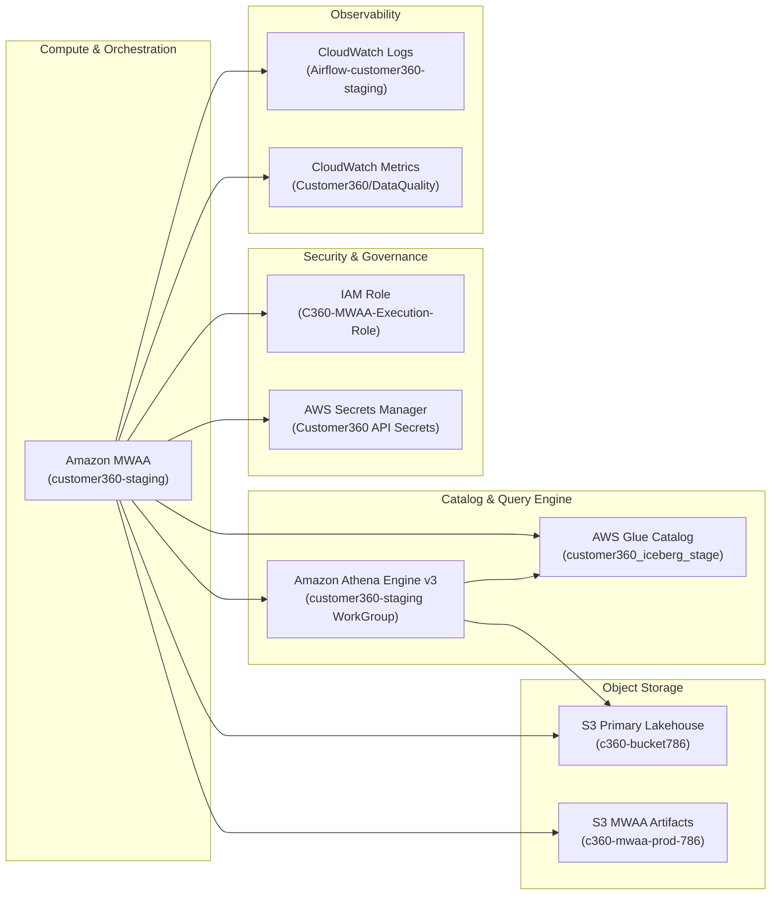

# Customer 360 Lakehouse — AWS Service Health & Infrastructure Audit

**Environment:** Staging / Production Foundation  
**AWS Account ID:** `734143568343`  
**Primary Region:** `us-east-1`  
**Audit Status:** Active & Verified  

---

## 1. AWS Infrastructure Inventory

---

## 2. Amazon MWAA (Managed Workflows for Apache Airflow)

| Parameter | Current Configuration | Health / Operational Status |
| :--- | :--- | :--- |
| **Environment Name** | `customer360-staging` | `AVAILABLE` (Healthy) |
| **Airflow Version** | `2.11.2` | Supported, secure release |
| **Python Version** | `3.12` | Fully compatible with modern dependencies |
| **Environment Class** | `mw1.small` | Sized appropriately for staging load |
| **Webserver Access** | Public network (with warning) | Accessible via IAM-authenticated Airflow UI |
| **Execution Role** | `arn:aws:iam::734143568343:role/C360-MWAA-Execution-Role` | Active, verified |
| **Source Bucket** | `arn:aws:s3:::c360-mwaa-prod-786` | Active |
| **DAG S3 Prefix** | `dags` | Active |
| **Requirements File S3**| `requirements.txt` (Version: `5jtfvX6VGg2w0PI5iM2L1NgUhD_ejrQn`) | Active |
| **Scheduler Count** | 2 | Redundant scheduling active |
| **Worker Count** | Min: 1, Max: 2 | Auto-scales under task queue pressure |

---

## 3. Amazon S3 Storage Layout Health

| Bucket Name | Purpose | SSE Encryption | Object Versioning | Lifecycle Rules | Health Status |
| :--- | :--- | :--- | :--- | :--- | :--- |
| `c360-bucket786` | Primary Data Lakehouse (Raw, Silver, Quarantine, Iceberg, Athena Results) | SSE-S3 (AES-256) | Enabled | Active on raw/quarantine prefixes | `HEALTHY` |
| `c360-mwaa-prod-786` | MWAA Deployment Assets (DAGs, Plugins, Requirements) | SSE-S3 (AES-256) | Enabled | Retain previous versions for rollback | `HEALTHY` |

### S3 Prefix Directory Health
- `s3://c360-bucket786/raw/` — Ingestion target. Populated by connectors.
- `s3://c360-bucket786/silver/` — Snappy Parquet files generated by Silver Gate.
- `s3://c360-bucket786/quarantine/` — Rejection JSONL logs with root cause descriptions.
- `s3://c360-bucket786/iceberg/customer360_iceberg_stage/` — Physical storage of Iceberg metadata and Parquet data files.
- `s3://c360-bucket786/athena-results/` — Temporary spill bucket for Athena query results. Automatically cleaned.

---

## 4. AWS Glue Data Catalog & Iceberg Tables

Database: `customer360_iceberg_stage` (Staging) / `customer360_iceberg_prod` (Production)

| Table Name | Classification | Format | Primary Key | Partition Key | Storage Location |
| :--- | :--- | :--- | :--- | :--- | :--- |
| `hubspot_contacts` | `ICEBERG` | PARQUET | `customer_id` | `ingestion_date` (`date`) | `s3://c360-bucket786/iceberg/customer360_iceberg_stage/hubspot_contacts` |
| `oms_orders` | `ICEBERG` | PARQUET | `order_id` | `ingestion_date` (`date`) | `s3://c360-bucket786/iceberg/customer360_iceberg_stage/oms_orders` |
| `pim_products` | `ICEBERG` | PARQUET | `product_id` | `ingestion_date` (`date`) | `s3://c360-bucket786/iceberg/customer360_iceberg_stage/pim_products` |
| `loyalty_loyalty` | `ICEBERG` | PARQUET | `loyalty_id` | `ingestion_date` (`date`) | `s3://c360-bucket786/iceberg/customer360_iceberg_stage/loyalty_loyalty` |
| `marketing_campaign_events` | `ICEBERG` | PARQUET | `member_id` | `ingestion_date` (`date`) | `s3://c360-bucket786/iceberg/customer360_iceberg_stage/marketing_campaign_events` |
| `zendesk_tickets` | `ICEBERG` | PARQUET | `ticket_id` | `ingestion_date` (`date`) | `s3://c360-bucket786/iceberg/customer360_iceberg_stage/zendesk_tickets` |

---

## 5. Amazon Athena Engine v3

| WorkGroup Name | Engine Version | Output S3 Location | Encryption | Status |
| :--- | :--- | :--- | :--- | :--- |
| `customer360-staging` | Athena Engine Version 3 | `s3://c360-bucket786/athena-results/staging/` | SSE-S3 | `ENABLED` |
| `primary` | Athena Engine Version 3 | Default / Bucket output | SSE-S3 | `ENABLED` |

### Key Capabilities Verified:
- ACID transactional support via Apache Iceberg table format.
- High-performance atomic `MERGE INTO` statement execution.
- Native maintenance commands: `OPTIMIZE customer360_iceberg_stage.{table} REWRITE DATA USING BIN_PACK;` and `VACUUM`.

---

## 6. Amazon CloudWatch Observability

### Log Groups
- `/aws/mwaa/customer360-staging/DAGProcessing` — Captures DAG compilation and parsing errors.
- `/aws/mwaa/customer360-staging/Scheduler` — Scheduler loop and heartbeat logs.
- `/aws/mwaa/customer360-staging/Task` — Task-level runtime logs (Airflow worker outputs).
- `/aws/mwaa/customer360-staging/WebServer` — Web UI and API access logs.

### Custom Metric Namespaces
- **Namespace:** `Customer360/DataQuality`
  - `RecordsInput` (Count)
  - `RecordsValid` (Count)
  - `RecordsInvalid` (Count)
  - `RejectionRatePct` (Percent)
  - `QualityGatePassed` (Binary 1/0)
- **Namespace:** `Customer360/Pipeline`
  - `PipelineSuccess` (Count)
  - `PipelineFailure` (Count)
  - `ExecutionDurationSeconds` (Seconds)

---

## 7. IAM Roles & Security Boundaries

### Role: `C360-MWAA-Execution-Role`
**Permissions Attached:**
1. **MWAA Execution Base Policy:** Allows Airflow worker task execution, CloudWatch logs emission, SQS queueing.
2. **S3 Lakehouse Full Access:** Read/Write access to `arn:aws:s3:::c360-bucket786` and `arn:aws:s3:::c360-mwaa-prod-786`.
3. **AWS Glue Catalog Access:** `glue:GetDatabase`, `glue:GetTable`, `glue:CreateTable`, `glue:UpdateTable`, `glue:BatchCreatePartition` on `customer360_iceberg_*`.
4. **Athena Query Execution:** `athena:StartQueryExecution`, `athena:GetQueryExecution`, `athena:GetQueryResults`, `athena:StopQueryExecution` on workgroup `customer360-staging`.
5. **CloudWatch Metrics Policy (`C360-MWAA-CloudWatch-Metrics-Policy`):** `cloudwatch:PutMetricData` for namespaces `Customer360/*`.
6. **Secrets Manager Policy:** `secretsmanager:GetSecretValue` for secrets prefixed with `customer360/*`.
