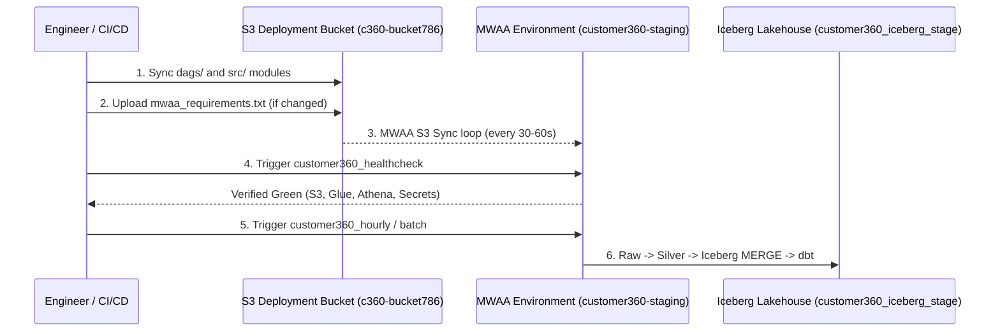

# Customer 360 Lakehouse — Deployment & Operations Runbook

**Audience:** Data Engineers, Site Reliability Engineers, DevOps Engineers  
**Classification:** Operational Runbook & Execution Guide  
**Target Environments:** AWS MWAA Staging (`customer360-staging`) & Production  

---

## 1. Quick Reference: Deployment Architecture

MWAA reads its DAG definitions, custom Python modules, and package dependencies from an Amazon S3 deployment bucket.



---

## 2. Step 1: Synchronize Codebase to Amazon S3

Because the local workstation environment does not have direct IAM credentials configured, execute the sync command from **AWS CloudShell** or an authenticated terminal.

### Option A: AWS CloudShell (Recommended)
1. Open the AWS Management Console and launch **AWS CloudShell** in region `us-east-1`.
2. Clone or pull the latest commit from the repository:
   ```bash
   git clone https://github.com/Muhammad-Saad12345/Customer_360-Production-ready-Data-Pipeline.git
   cd Customer_360-Production-ready-Data-Pipeline/customer360
   git pull origin main
   ```
3. Synchronize `src/` modules and `dags/` to the MWAA DAGs bucket:
   ```bash
   # Sync source modules to S3 dags/src prefix
   aws s3 sync src/ s3://c360-bucket786/dags/src/ \
     --exclude "*/__pycache__/*" \
     --exclude "*.pyc" \
     --delete \
     --region us-east-1

   # Sync DAG definitions to S3 dags prefix
   aws s3 sync dags/ s3://c360-bucket786/dags/ \
     --exclude "__pycache__/*" \
     --exclude "*.pyc" \
     --region us-east-1

   # Sync dbt models and configuration
   aws s3 sync dbt/ s3://c360-bucket786/dags/dbt/ \
     --exclude "target/*" \
     --exclude "dbt_packages/*" \
     --region us-east-1
   ```

### Option B: Local PowerShell (with configured AWS credentials)
```powershell
aws s3 sync src/ s3://c360-bucket786/dags/src/ --exclude "*/__pycache__/*" --exclude "*.pyc" --delete --region us-east-1
aws s3 sync dags/ s3://c360-bucket786/dags/ --exclude "__pycache__/*" --exclude "*.pyc" --region us-east-1
aws s3 sync dbt/ s3://c360-bucket786/dags/dbt/ --exclude "target/*" --region us-east-1
```

---

## 3. Step 2: MWAA Requirements Management

If any python package dependencies change:
1. Ensure the constraint header is present at the top of `mwaa_requirements.txt`:
   ```
   --constraint "https://raw.githubusercontent.com/apache/airflow/constraints-2.11.2/constraints-3.12.txt"
   pyarrow==17.0.0
   pydantic>=2.0.0
   requests>=2.31.0
   ```
2. Upload the file to the MWAA artifact bucket:
   ```bash
   aws s3 cp mwaa_requirements.txt s3://c360-mwaa-prod-786/requirements.txt --region us-east-1
   ```
3. Update the MWAA environment in the AWS Console (or via CLI) to trigger a rolling update of the Celery workers:
   ```bash
   aws mwaa update-environment \
     --name customer360-staging \
     --requirements-s3-path requirements.txt \
     --region us-east-1
   ```

---

## 4. Step 3: Operational Execution Sequence

Always follow this 3-phase execution order when verifying a fresh deployment:

### Phase 1: Diagnostic Healthcheck
1. Navigate to the MWAA Airflow UI (`https://<mwaa-webserver-url>.airflow.us-east-1.amazonaws.com`).
2. Trigger the DAG: **`customer360_healthcheck`**.
3. **Expected Result:** All 4 tasks must complete in green within 45 seconds:
   - `check_s3_lakehouse` (PASS)
   - `check_glue_catalog` (PASS)
   - `check_athena_engine` (PASS)
   - `check_secrets_manager` (PASS)

### Phase 2: Hourly Incremental Validation
1. Trigger the DAG: **`customer360_hourly`**.
2. **Execution Flow:**
   `ingest_hubspot` ➔ `validate_and_write_silver_hubspot` ➔ `quality_check_hubspot` ➔ `load_iceberg_hubspot`
3. **Expected Result:**
   - Ingests new/updated CRM contacts.
   - Generates Silver Parquet and reconciles record count.
   - Merges records into `customer360_iceberg_stage.hubspot_contacts` via Athena Engine v3.

### Phase 3: Comprehensive Batch Validation
1. Trigger the DAG: **`customer360_batch`**.
2. **Execution Flow:**
   - 6 parallel ingestion tasks (`ingest_hubspot`, `ingest_oms`, `ingest_pim`, `ingest_loyalty`, `ingest_marketing`, `ingest_support`)
   - 6 parallel silver gates
   - 6 quality gates asserting $\text{rejection\_rate} < 10\%$
   - 6 atomic Iceberg `MERGE INTO` tasks
   - `dbt_run` (compiles and materializes all staging, dimension, fact, identity, and mart models)
   - `dbt_test` (validates uniqueness, non-null, and referential integrity)
   - `iceberg_maintenance` (executes `OPTIMIZE` bin-packing and `VACUUM` orphan cleanup)

---

## 5. Step 4: Amazon Athena Verification Queries

After the batch DAG completes, run these verification queries in the Amazon Athena Query Editor (WorkGroup: `customer360-staging`):

### 1. Verify Row Counts Across All Active Iceberg Tables
```sql
SELECT 'hubspot_contacts' AS table_name, count(*) AS total_rows FROM customer360_iceberg_stage.hubspot_contacts
UNION ALL
SELECT 'oms_orders', count(*) FROM customer360_iceberg_stage.oms_orders
UNION ALL
SELECT 'pim_products', count(*) FROM customer360_iceberg_stage.pim_products
UNION ALL
SELECT 'loyalty_loyalty', count(*) FROM customer360_iceberg_stage.loyalty_loyalty
UNION ALL
SELECT 'marketing_campaign_events', count(*) FROM customer360_iceberg_stage.marketing_campaign_events
UNION ALL
SELECT 'zendesk_tickets', count(*) FROM customer360_iceberg_stage.zendesk_tickets;
```

### 2. Verify Primary Key Uniqueness (Zero Duplicate Invariant)
```sql
SELECT customer_id, count(*) AS occurrences
FROM customer360_iceberg_stage.hubspot_contacts
GROUP BY customer_id
HAVING count(*) > 1;
```
*(Query must return 0 rows).*

### 3. Query the Unified Customer 360 Mart
```sql
SELECT 
    master_customer_id,
    full_name,
    primary_email,
    loyalty_tier,
    loyalty_points,
    total_orders,
    lifetime_revenue,
    average_order_value,
    open_support_cases,
    marketing_engagement_status
FROM customer360_iceberg_stage.customer_360
LIMIT 20;
```

---

## 6. Step 5: Troubleshooting & Incident Triage Guide

| Symptom | Diagnostic Step | Immediate Fix |
| :--- | :--- | :--- |
| **DAG Import Error in Airflow UI** | Check CloudWatch Log Group: `/aws/mwaa/customer360-staging/DAGProcessing` | Verify `sys.path` injection at top of DAG; verify S3 sync for `src/` completed. |
| **Task Failure on Ingestion** | Check task log for `ALLOW_SYNTHETIC_FALLBACK` | If running in staging without live creds, ensure `ALLOW_SYNTHETIC_FALLBACK=true` in environment. |
| **Athena Query Execution Error** | Check query string and error in `/aws/mwaa/customer360-staging/Task` | Verify table exists in Glue catalog; verify Athena workgroup output location is writable. |
| **Quality Gate Rejection Exceeded** | Inspect quarantine file: `s3://c360-bucket786/quarantine/{source}/{entity}/.../quarantined.jsonl` | Read `rejection_reasons` array in JSON payload to determine schema drift or corrupt upstream source data. |
| **dbt-athena Compilation Error** | Check task log of `dbt_run` | Verify `profiles.yml` points to `customer360_iceberg_stage` and Athena output bucket exists. |

---

## 7. Rollback Procedures

If an unrecoverable failure occurs in a newly deployed DAG or code version:
1. Revert to the previous known good Git commit:
   ```bash
   git revert HEAD
   git push origin main
   ```
2. Re-sync previous version to S3:
   ```bash
   aws s3 sync src/ s3://c360-bucket786/dags/src/ --delete --region us-east-1
   aws s3 sync dags/ s3://c360-bucket786/dags/ --region us-east-1
   ```
3. If Iceberg table metadata is corrupted, roll back the table state to a prior snapshot timestamp using Iceberg time travel:
   ```sql
   CALL customer360_iceberg_stage.system.rollback_to_snapshot('hubspot_contacts', <SNAPSHOT_ID>);
   ```
