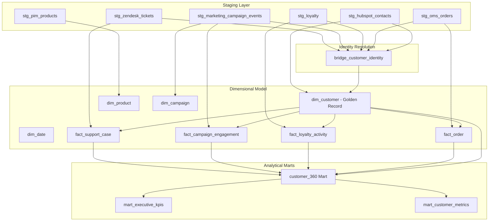

# Customer 360 Lakehouse — End-to-End Integration Baseline

**Document Version:** 2.0.0  
**Environment:** AWS Staging (`customer360-staging`) / Local Development  
**Region:** `us-east-1`  
**Primary AWS Account:** `734143568343`  
**Authoritative Classification:** Complete Architectural Inventory & System Baseline  

---

## 1. Executive Summary & Baseline State

The **Customer 360 Data Lakehouse** is an enterprise data engineering platform designed to consolidate customer data across CRM, Order Management, Product Information, Loyalty, Marketing, and Customer Support domains into a unified, queryable, ACID-compliant Lakehouse.

The system is implemented using:
- **Cloud Infrastructure:** Amazon Web Services (AWS)
- **Object Storage & Lakehouse Format:** Amazon S3 with Apache Iceberg tables
- **Metadata Catalog:** AWS Glue Data Catalog
- **Interactive Query Engine:** Amazon Athena Engine v3
- **Data Transformation & Modeling:** dbt-athena (dbt-core 1.8+)
- **Orchestration:** Managed Workflows for Apache Airflow (MWAA v2.11.2, Python 3.12)
- **Monitoring & Observability:** Amazon CloudWatch Metrics & Logs

### Baseline Validation Snapshot
- **Total Local Unit & Integration Tests:** 211 Passed / 0 Failed (100% pass rate)
- **DAG Parsing:** Validated (`customer360_batch`, `customer360_hourly`, `customer360_healthcheck`)
- **Source Ownership Rules:** Strictly enforced; zero cross-domain leakage
- **Airflow Idempotency:** Guaranteed across raw extraction, silver gate Parquet generation, and Athena Iceberg `MERGE INTO` operations

---

## 2. Authoritative Source Ownership Matrix

A central tenet of the Customer 360 platform is **strict single-source ownership**. Conflicting source entities are strictly prohibited from writing to domains they do not own.

| Domain Entity | Primary Source System | Owned Entities / Fields | Strictly Prohibited Ingestion | Destination Iceberg Table | Business Key |
| :--- | :--- | :--- | :--- | :--- | :--- |
| **CRM / Contacts** | **HubSpot** | Contact profile, email, phone, lifecycle stage | Orders, Products | `hubspot_contacts` | `customer_id` |
| **Order Management** | **OMS** | Orders, line items, order status, totals, currency | Customer profile overwrites | `oms_orders` | `order_id` |
| **Product Catalog** | **PIM** | Products, SKUs, category, price, brand, status | Inventory transactions | `pim_products` | `product_id` |
| **Loyalty & Rewards** | **Loyalty Engine** | Tiers, points balance, earn/redeem timestamps | Customer master records | `loyalty_loyalty` | `loyalty_id` |
| **Email & Marketing** | **Marketing (Mailchimp)** | Campaign events, sends, opens, clicks, status | Order attribution | `marketing_campaign_events` | `member_id`, `customer_id` |
| **Customer Support** | **Zendesk / Support** | Tickets, channels, priorities, CSAT scores | Direct contact creation | `zendesk_tickets` | `ticket_id` |

> [!IMPORTANT]
> **HubSpot Ownership Boundary:** HubSpot is restricted to **contacts only**. Any order or product payloads originating from HubSpot are automatically rejected and routed to quarantine by `HubSpotSilverProcessor`.

---

## 3. Storage Layout & Path Taxonomy

All Lakehouse storage artifacts reside in Amazon S3 under deterministic, date-partitioned prefixes.

```
s3://c360-bucket786/
├── raw/                                  # Immutable raw landing zone (JSON)
│   ├── hubspot/contacts/ingestion_date=YYYY-MM-DD/run_id=<UUID>/data.json
│   ├── oms/orders/ingestion_date=YYYY-MM-DD/run_id=<UUID>/data.json
│   ├── pim/products/ingestion_date=YYYY-MM-DD/run_id=<UUID>/data.json
│   ├── loyalty/loyalty/ingestion_date=YYYY-MM-DD/run_id=<UUID>/data.json
│   ├── marketing/campaign_events/ingestion_date=YYYY-MM-DD/run_id=<UUID>/data.json
│   └── support/tickets/ingestion_date=YYYY-MM-DD/run_id=<UUID>/data.json
├── silver/                               # Validated, schema-conformed records (Snappy Parquet)
│   ├── hubspot/contacts/ingestion_date=YYYY-MM-DD/run_id=<UUID>/part-00000.parquet
│   ├── oms/orders/ingestion_date=YYYY-MM-DD/run_id=<UUID>/part-00000.parquet
│   ├── pim/products/ingestion_date=YYYY-MM-DD/run_id=<UUID>/part-00000.parquet
│   ├── loyalty/loyalty/ingestion_date=YYYY-MM-DD/run_id=<UUID>/part-00000.parquet
│   ├── marketing/campaign_events/ingestion_date=YYYY-MM-DD/run_id=<UUID>/part-00000.parquet
│   └── support/tickets/ingestion_date=YYYY-MM-DD/run_id=<UUID>/part-00000.parquet
├── quarantine/                           # Rejection zone for failed data contracts (JSON Lines)
│   └── {source}/{entity}/ingestion_date=YYYY-MM-DD/run_id=<UUID>/quarantined.jsonl
├── iceberg/                              # Apache Iceberg Lakehouse physical storage
│   ├── customer360_iceberg_stage/        # Staging catalog warehouse
│   │   ├── hubspot_contacts/data/ & metadata/
│   │   ├── oms_orders/data/ & metadata/
│   │   ├── pim_products/data/ & metadata/
│   │   ├── loyalty_loyalty/data/ & metadata/
│   │   ├── marketing_campaign_events/data/ & metadata/
│   │   └── zendesk_tickets/data/ & metadata/
│   └── customer360_iceberg_prod/         # Production catalog warehouse (promoted)
├── athena-results/                       # Athena query execution spill & output
└── dags/                                 # MWAA Dag, source plugins, & dependency deployment
    ├── customer360_batch.py
    ├── customer360_hourly.py
    ├── customer360_healthcheck.py
    ├── src/                              # Synced codebase modules
    └── dbt/                              # dbt project and models
```

---

## 4. Apache Iceberg Lakehouse Baseline Specifications

All Iceberg tables are registered under the Glue Database `customer360_iceberg_stage` (and `customer360_iceberg_prod` in production).

### Table Schema & Partitioning Catalog

| Table Name | Entity | Partition Spec | Table Format | Compression | Write Mode |
| :--- | :--- | :--- | :--- | :--- | :--- |
| `hubspot_contacts` | Contacts | `ingestion_date` (`date`) | Apache Iceberg | Snappy Parquet | Athena MERGE INTO |
| `oms_orders` | Orders | `ingestion_date` (`date`) | Apache Iceberg | Snappy Parquet | Athena MERGE INTO |
| `pim_products` | Products | `ingestion_date` (`date`) | Apache Iceberg | Snappy Parquet | Athena MERGE INTO |
| `loyalty_loyalty` | Loyalty | `ingestion_date` (`date`) | Apache Iceberg | Snappy Parquet | Athena MERGE INTO |
| `marketing_campaign_events` | Campaign Events | `ingestion_date` (`date`) | Apache Iceberg | Snappy Parquet | Athena MERGE INTO |
| `zendesk_tickets` | Support Tickets | `ingestion_date` (`date`) | Apache Iceberg | Snappy Parquet | Athena MERGE INTO |

### Table DDL Template (Athena Engine v3)
```sql
CREATE TABLE IF NOT EXISTS customer360_iceberg_stage.hubspot_contacts (
    customer_id string COMMENT 'HubSpot unique contact ID (Business Key)',
    record_id string COMMENT 'Unified record identifier',
    first_name string COMMENT 'Customer first name',
    last_name string COMMENT 'Customer last name',
    email string COMMENT 'Customer primary email address',
    phone string COMMENT 'Customer primary phone number',
    customer_stage string COMMENT 'CRM lifecycle stage e.g. lead, customer',
    created_at string COMMENT 'Contact creation timestamp ISO-8601',
    updated_at string COMMENT 'Contact last modification timestamp ISO-8601',
    owner_id string COMMENT 'HubSpot owner user ID',
    source string COMMENT 'Originating source system name',
    entity string COMMENT 'Originating entity name',
    run_id string COMMENT 'Airflow pipeline batch execution UUID',
    ingestion_timestamp string COMMENT 'Timestamp when record was processed into Silver',
    ingestion_date date COMMENT 'Partition date extracted from ingestion_timestamp'
)
PARTITIONED BY (ingestion_date)
LOCATION 's3://c360-bucket786/iceberg/customer360_iceberg_stage/hubspot_contacts'
TBLPROPERTIES (
    'table_type'='ICEBERG',
    'format'='parquet',
    'write_compression'='snappy'
);
```

---

## 5. dbt Model Hierarchy & Dimensional Architecture

The downstream transformation layer is built with dbt and organized into distinct dimensional and mart layers:



---

## 6. Airflow Orchestration Baseline

Three production DAGs are configured and maintained in the environment:

1. **`customer360_healthcheck`**
   - **Trigger:** Scheduled hourly / on-demand diagnostic
   - **Scope:** Validates S3 bucket read/write, Glue Catalog connectivity, Athena query execution, and AWS Secrets Manager access.
   - **SLA:** Executes within 45 seconds.

2. **`customer360_hourly`**
   - **Trigger:** Scheduled hourly (`@hourly`)
   - **Scope:** Fast incremental HubSpot CRM contacts ingestion -> Silver Gate -> Rejection Policy Check -> Iceberg MERGE.
   - **Idempotency:** Driven by `CheckpointStore` watermark and intra-batch key deduplication.

3. **`customer360_batch`**
   - **Trigger:** Manual / Scheduled daily (`@daily` or triggered on demand)
   - **Scope:** End-to-end multi-source batch run across all 6 domains, followed by dbt model compilation, dbt test execution, and Iceberg lakehouse maintenance (OPTIMIZE / VACUUM).

---

## 7. Configuration & Environment Variables

| Variable | Staging Value | Production Value | Purpose |
| :--- | :--- | :--- | :--- |
| `ENVIRONMENT` | `staging` | `production` | Selects catalog, bucket, and credential policies |
| `AWS_REGION` | `us-east-1` | `us-east-1` | Primary infrastructure region |
| `S3_BUCKET` | `c360-bucket786` | `c360-bucket786` | Primary lakehouse storage bucket |
| `MWAA_BUCKET` | `c360-mwaa-prod-786` | `c360-mwaa-prod-786` | MWAA Airflow deployment artifact bucket |
| `GLUE_DATABASE` | `customer360_iceberg_stage` | `customer360_iceberg_prod` | Glue catalog database for Iceberg tables |
| `ATHENA_WORKGROUP` | `customer360-staging` | `customer360-prod` | Athena query execution isolation workgroup |
| `ALLOW_SYNTHETIC_FALLBACK` | `true` | `false` | Enables controlled synthetic record generation in staging |
| `DQ_REJECT_HARD_PCT` | `10.0` | `5.0` | Hard threshold for DQ gate failure (% rejected records) |
| `DQ_REJECT_WARN_PCT` | `5.0` | `2.0` | Soft threshold for DQ gate warning logging |
