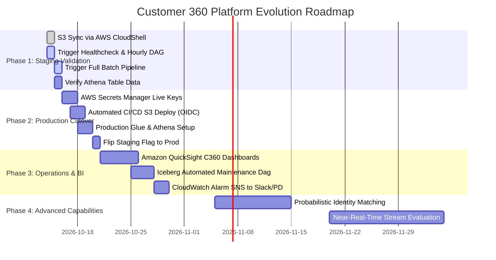

# Customer 360 Lakehouse — Next Steps & Technical Roadmap

**Document Version:** 2.0.0  
**Horizon:** Immediate (Week 1) through Long-Term (Quarter 2)  
**Target:** Engineering Leadership, Data Engineers, DevOps  

---

## 1. Roadmap Horizon Overview



---

## 2. Phase 1: Immediate Actions (Staging Operational Run)

### 1.1 Synchronize Updated Code to S3
- **Action:** Open AWS CloudShell or an authenticated shell and execute:
  ```bash
  aws s3 sync src/ s3://c360-bucket786/dags/src/ --exclude "*/__pycache__/*" --exclude "*.pyc" --delete --region us-east-1
  aws s3 sync dags/ s3://c360-bucket786/dags/ --exclude "__pycache__/*" --exclude "*.pyc" --region us-east-1
  aws s3 sync dbt/ s3://c360-bucket786/dags/dbt/ --exclude "target/*" --region us-east-1
  ```
- **Rationale:** Pushes the commit `990ce8b` and `f64e79b` fixes (`valid_count` NameError resolution and synthetic fallback bypass) to the S3 bucket where MWAA workers pull DAG definitions.

### 1.2 Operational Execution Sequence in MWAA Web UI
1. **Trigger `customer360_healthcheck`:** Verify all 4 diagnostic tasks (`s3`, `glue`, `athena`, `secrets`) pass in green.
2. **Trigger `customer360_hourly`:** Verify CRM contacts incremental ingestion and Athena `MERGE INTO`.
3. **Trigger `customer360_batch`:** Verify end-to-end multi-source execution, dbt models, and Iceberg maintenance.

### 1.3 Validate Athena Query Results
- Open Athena Query Editor (WorkGroup: `customer360-staging`) and run:
  ```sql
  SELECT count(*) FROM customer360_iceberg_stage.customer_360;
  ```
- Verify non-zero rows and zero duplicate `master_customer_id` records.

---

## 3. Phase 2: Short-Term Enhancements (Production Cutover)

### 2.1 Live Secrets Injection in AWS Secrets Manager
- Store authenticated API tokens in AWS Secrets Manager:
  - `customer360/production/hubspot_token` (HubSpot OAuth Access Token / Private App Token)
  - `customer360/production/mailchimp_api_key` (Mailchimp API Key)
  - `customer360/production/zendesk_token` (Zendesk API Token + User Email)
  - OMS, PIM, and Loyalty production API URLs and Bearer tokens.

### 2.2 Automated GitHub Actions Deployment (Zero-Touch CI/CD)
- Implement AWS OIDC role in `.github/workflows/deploy.yml`:
  ```yaml
  - name: Configure AWS Credentials
    uses: aws-actions/configure-aws-credentials@v4
    with:
      role-to-assume: arn:aws:iam::734143568343:role/C360-GitHub-Actions-Deployer
      aws-region: us-east-1

  - name: Deploy DAGs and Source to S3
    run: |
      aws s3 sync src/ s3://c360-bucket786/dags/src/ --delete --exclude "*/__pycache__/*"
      aws s3 sync dags/ s3://c360-bucket786/dags/ --exclude "__pycache__/*"
      aws s3 sync dbt/ s3://c360-bucket786/dags/dbt/ --exclude "target/*"
  ```

### 2.3 Production Environment Promotion
- Create Glue database `customer360_iceberg_prod`.
- Create Athena WorkGroup `customer360-prod` with query result encryption.
- Set MWAA Airflow environment variables:
  ```
  ENVIRONMENT=production
  ALLOW_SYNTHETIC_FALLBACK=false
  GLUE_DATABASE=customer360_iceberg_prod
  ATHENA_WORKGROUP=customer360-prod
  ```

---

## 4. Phase 3: Medium-Term Enhancements (BI & Alerting)

### 3.1 Business Intelligence Integration (Amazon QuickSight)
- Connect Amazon QuickSight to Athena WorkGroup `customer360-staging` / `customer360-prod`.
- Direct query `customer360_iceberg_stage.customer_360` and `mart_executive_kpis`.
- Build visualizations for:
  - Executive KPI summary (Total Spend, AOV, Active Customer Count).
  - RFM Segmentation Distribution (Champions, Loyal, At-Risk, Churned).
  - Support Ticket CSAT vs. Customer Lifetime Value.

### 3.2 Automated CloudWatch Alarms & Alert Dispatch
- Create CloudWatch Alarm on `Customer360/DataQuality/QualityGatePassed == 0`.
- Wire alarm to an Amazon SNS topic subscribed to PagerDuty or an engineering Slack channel (`#c360-alerts`).
- Create CloudWatch Alarm on MWAA DAG failure metric.

### 3.3 Dedicated Iceberg Maintenance DAG
- Extract `iceberg_maintenance` from the batch DAG into a standalone daily/weekly DAG (`customer360_maintenance.py`).
- Run snapshot retention expiration (`VACUUM`) every 7 days.
- Run bin-pack file compaction (`OPTIMIZE`) after large backfill operations.

---

## 5. Phase 4: Long-Term Architectural Evolution

### 4.1 Probabilistic / Fuzzy Identity Resolution
- Current identity resolution uses deterministic matching (HubSpot ID -> Exact Email -> Exact Phone).
- If customer matching rate drops below 90% due to legacy data discrepancies:
  - Introduce intermediate probabilistic matching model (Jaro-Winkler string similarity on full name + zip code).
  - Maintain an auditable `match_confidence` score (e.g. `>= 0.85`).
  - Route low-confidence matches (`< 0.85`) to an identity exception queue for manual stewardship.

### 4.2 Near-Real-Time Streaming Evaluation
- If business SLAs require order or support ticket updates in minutes rather than hours:
  - Evaluate Amazon Kinesis Data Streams / MSK (Managed Streaming for Apache Kafka) to ingest events.
  - Land streaming records directly into S3 Raw via Amazon Kinesis Data Firehose with dynamic partitioning.
  - Retain Apache Iceberg as the transactional lakehouse destination using Iceberg streaming append.
