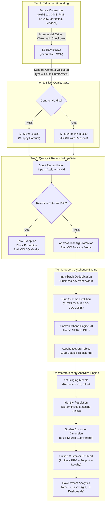

# Customer 360 Lakehouse — End-to-End Pipeline Flow Explained

**Audience:** Data Engineers, Analytics Engineers, Platform Architects, and Stakeholders  
**Scope:** Complete Data Lifecycle from Ingestion to Golden Customer 360 Analytics  

---

## 1. High-Level Pipeline Architecture

The Customer 360 platform processes heterogeneous source systems through a structured **4-Tier Data Lakehouse Pattern** followed by an **Analytics Transformation Engine**.



---

## 2. Detailed Phase-by-Phase Lifecycle

### Phase 1: Ingestion & Raw Landing (Tier 1)
1. **Incremental Extraction:**
   - Every source connector inherits from `BaseIngest` (`src/ingestion/base.py`).
   - The connector queries `CheckpointStore` (`src/checkpoint.py`) to retrieve the last successful high-watermark timestamp (e.g., `updated_at` or `order_ts`).
   - To guard against late-arriving data, an incremental lookback window (default 15 minutes) is applied:
     $$\text{Watermark}_{\text{effective}} = \text{Watermark}_{\text{checkpoint}} - \Delta t_{\text{lookback}}$$
2. **Resilient Data Retrieval:**
   - In live production, connectors invoke authenticated REST APIs (HubSpot OAuth, Mailchimp API keys, Zendesk Bearer tokens).
   - In staging or local development, when external credentials are absent and `ALLOW_SYNTHETIC_FALLBACK=true`, connectors generate deterministic, synthetic datasets so that testing and pipeline validation can run end-to-end without external dependencies.
3. **Immutable S3 Raw Persistence:**
   - The raw JSON payload is written to S3 under an immutable, partitioned key:
     `s3://{BUCKET}/raw/{source}/{entity}/ingestion_date={YYYY-MM-DD}/run_id={UUID}/data.json`
   - Raw records are never mutated or updated in place; they serve as an immutable audit trail for replayability.

---

### Phase 2: Silver Quality Gate & Quarantine (Tier 2)
1. **Schema Contract Enforcement:**
   - Raw records are validated record-by-record against strict data contracts (`src/processing/silver_gate.py` and `src/contracts/data_contracts.py`).
   - Each contract specifies:
     - **Required Fields:** Missing mandatory fields cause immediate failure.
     - **Datatype & Timestamp Parsing:** Strict ISO-8601 validation (`YYYY-MM-DDTHH:MM:SSZ`).
     - **Format Rules:** Regex validation for emails (`^[a-zA-Z0-9_.+-]+@[a-zA-Z0-9-]+\.[a-zA-Z0-9-.]+$`).
     - **Domain Enumerations:** E.g., `order_status` in `{'paid', 'shipped', 'fulfilled', 'cancelled', 'pending', 'refunded'}`.
     - **Numeric Boundaries:** E.g., `net_total >= 0`, `csat_score BETWEEN 0 AND 5`.
2. **Bifurcated Routing:**
   - **Clean Records:** Promoted to Silver, standardized into columnar format, and saved as Snappy Parquet:
     `s3://{BUCKET}/silver/{source}/{entity}/ingestion_date={YYYY-MM-DD}/run_id={UUID}/part-00000.parquet`
   - **Corrupt / Invalid Records:** Diverted to the Quarantine bucket in JSON Lines format:
     `s3://{BUCKET}/quarantine/{source}/{entity}/ingestion_date={YYYY-MM-DD}/run_id={UUID}/quarantined.jsonl`
   - Every quarantined record is enriched with metadata:
     ```json
     {
       "record": { "order_id": "ORD-BAD", "customer_id": "" },
       "rejection_reasons": ["Missing required field: customer_id"],
       "rejection_timestamp": "2026-10-14T09:00:00Z",
       "source": "oms",
       "entity": "orders",
       "run_id": "674f07a2-..."
     }
     ```

---

### Phase 3: Quality Gate Reconciliation & Policy (Tier 3)
1. **Bookkeeping Invariant Check:**
   - The pipeline computes and asserts:
     $$\text{Input Count} = \text{Valid Silver Count} + \text{Quarantined Count}$$
   - Any mathematical mismatch raises an immediate `ValueError`, blocking promotion.
2. **Rejection-Rate Policy:**
   - Rejection percentage is calculated:
     $$\text{Rejection Rate} = \frac{\text{Invalid Count}}{\text{Input Count}} \times 100\%$$
   - **Soft Warning (`>= 5.0%`):** Emits a CloudWatch warning log and metric, allowing non-critical pipelines to continue.
   - **Hard Blocking (`>= 10.0%`):** Raises an exception, aborts downstream tasks, and blocks Iceberg promotion to protect table integrity.
3. **CloudWatch Metrics Dispatch:**
   - Emits custom metrics to namespace `Customer360/DataQuality`:
     - `RecordsInput`, `RecordsValid`, `RecordsInvalid`, `RejectionRatePct`, `QualityGatePassed`.

---

### Phase 4: Apache Iceberg Lakehouse Ingestion (Tier 4)
1. **Intra-Batch Primary Key Deduplication:**
   - If an extraction batch contains multiple records sharing the same primary business key (e.g. rapid order status updates `paid` -> `shipped`), records are ordered by update timestamp descending, and only the latest record is promoted.
2. **Automated Schema Evolution:**
   - The loader queries the Glue Data Catalog for the current table schema.
   - If new valid columns appear in the incoming Silver Parquet schema, `IcebergLoader` executes an Athena DDL:
     `ALTER TABLE customer360_iceberg_stage.{table} ADD COLUMNS (new_col string COMMENT 'Dynamically added column');`
3. **Atomic Athena `MERGE INTO`:**
   - Instead of costly full table rewrites, changes are merged atomically using Athena Engine v3:
     ```sql
     MERGE INTO customer360_iceberg_stage.oms_orders AS target
     USING staging_silver_view AS source
     ON target.order_id = source.order_id
     WHEN MATCHED THEN
       UPDATE SET
         customer_id = source.customer_id,
         order_ts = source.order_ts,
         order_status = source.order_status,
         net_total = source.net_total,
         updated_at = source.updated_at,
         run_id = source.run_id
     WHEN NOT MATCHED THEN
       INSERT (order_id, customer_id, order_ts, order_status, net_total, updated_at, run_id, ingestion_date)
       VALUES (source.order_id, source.customer_id, source.order_ts, source.order_status, source.net_total, source.updated_at, source.run_id, source.ingestion_date);
     ```

---

### Phase 5: dbt Transformations & Identity Resolution

Once records reside in Apache Iceberg, dbt-athena executes the analytics transformation pipeline.

#### 1. Staging (`dbt/models/staging/`)
- Views directly querying Iceberg silver tables.
- Standardizes column naming (`stg_hubspot_contacts`, `stg_oms_orders`, etc.).
- Normalizes email formatting (`lower(trim(email))`), phone numbers, and timestamps.

#### 2. Identity Resolution (`dbt/models/identity/bridge_customer_identity.sql`)
- Creates a deterministic identity bridge across all source systems:
  - **Match Rule 1 (Direct Key):** HubSpot `customer_id` is master.
  - **Match Rule 2 (Exact Email):** Normalized email address exact match.
  - **Match Rule 3 (Exact Phone):** Normalized E.164 phone number match.
- Produces `master_customer_id` mapping each system's local customer key with confidence scoring and audit metadata.

#### 3. Golden Record Dimension (`dbt/models/dimensions/dim_customer.sql`)
- Multi-source survivorship model:
  - **Name & Email:** Authoritative source = **HubSpot CRM**
  - **Loyalty Tier & Points:** Authoritative source = **Loyalty System**
  - **Purchase History & Lifetime Value:** Authoritative source = **OMS Orders**
  - **Support CSAT & Open Cases:** Authoritative source = **Zendesk**
  - **Engagement Status:** Authoritative source = **Marketing Events**

#### 4. Unified Customer 360 Mart (`dbt/models/marts/customer_360.sql`)
- Single unified table combining customer profile, total lifetime spend, average order value (AOV), RFM segmentation (Recency, Frequency, Monetary), loyalty standing, campaign engagement, and support ticket history.
- Consumed by BI dashboards, executive reporting, and downstream operational tools.
