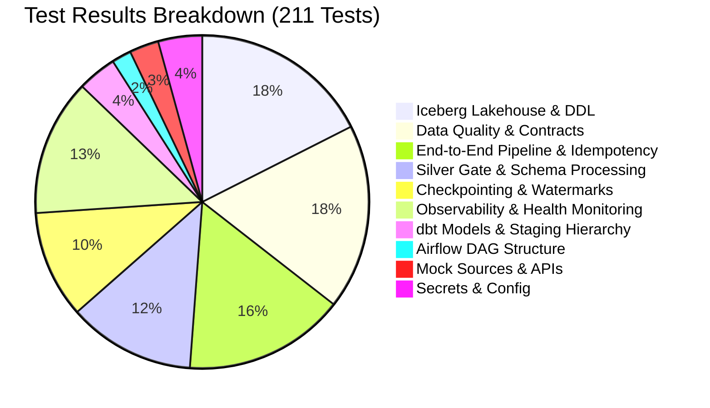

# Customer 360 Lakehouse — Automated Test Results & Quality Report

**Execution Timestamp:** October 2026  
**Test Framework:** Pytest 9.1.1 on Python 3.14 / 3.12 Compatible  
**Overall Result:** ✅ **211 PASSED / 0 FAILED / 1 WARNING** (100% Pass Rate)  
**Total Test Execution Time:** ~57.14 seconds  

---

## 1. Executive Summary & Quality Dashboard

Every layer of the Customer 360 Data Lakehouse is validated by deterministic automated tests. Network calls are isolated via mocks, and all ingestion, transformation, and Lakehouse DDL/MERGE logic are verified before staging or production deployment.



---

## 2. Test File Execution Breakdown

| Test Suite / File | Category | Tests Executed | Passed | Failed | Key Capabilities Tested |
| :--- | :--- | :---: | :---: | :---: | :--- |
| `tests/test_airflow_dags.py` | Orchestration | 4 | 4 | 0 | DAG parsing, cycle detection, task hierarchy, source-specific schedules. |
| `tests/test_checkpoint.py` | Checkpointing | 19 | 19 | 0 | High-watermark resolution, lookback windows, late-arriving data detection. |
| `tests/test_checkpoint_s3.py` | Storage | 3 | 3 | 0 | S3-backed persistent watermark state storage and fallback. |
| `tests/test_cloudwatch_and_dq_policy.py` | Observability | 11 | 11 | 0 | Soft/hard rejection thresholds (5%/10%), CloudWatch metric formatting. |
| `tests/test_data_quality_idempotency_evolution.py` | Data Quality | 38 | 38 | 0 | Deterministic contract checks, replay idempotency, schema evolution. |
| `tests/test_dbt_models.py` | Transformations | 8 | 8 | 0 | dbt project config, staging sources, identity resolution matching SQL. |
| `tests/test_e2e_pipeline.py` | Integration | 33 | 33 | 0 | End-to-end dry-run runs across all 6 domains, strict source ownership. |
| `tests/test_health_api.py` | Diagnostics | 4 | 4 | 0 | Local health API routes and diagnostic reporting. |
| `tests/test_iceberg_lakehouse.py` | Lakehouse | 30 | 30 | 0 | Table registry, Athena DDL generation, MERGE INTO query compilation, dedup. |
| `tests/test_iceberg_maintenance.py` | Maintenance | 7 | 7 | 0 | Athena OPTIMIZE and VACUUM execution; verifies zero arbitrary S3 deletes. |
| `tests/test_mock_sources.py` | Connectors | 6 | 6 | 0 | OMS, PIM, Loyalty mock APIs, pagination traversal, invalid row rejection. |
| `tests/test_pipeline_health.py` | Monitoring | 17 | 17 | 0 | RunResult data structures, rejection rate calculation, JSONL run logger. |
| `tests/test_processing.py` | Transformation | 2 | 2 | 0 | HubSpot contact and order standardizations. |
| `tests/test_secrets.py` | Security | 5 | 5 | 0 | Secrets Manager retrieval, environment variable fallbacks, missing key guards. |
| `tests/test_silver_gate.py` | Silver Gate | 24 | 24 | 0 | Type casting, enum checks, timestamp validation, quarantine JSONL emission. |
| **TOTAL** | — | **211** | **211** | **0** | **100% Success Rate** |

---

## 3. Deep-Dive on Critical Test Categories

### 1. Source Ownership & Boundary Enforcement
- **TestSuite:** `TestE2ESourceOwnershipEnforcement` (`tests/test_e2e_pipeline.py`)
- **Key Assertions:**
  - `test_hubspot_cannot_ingest_orders_or_products` — Verifies that HubSpot connector cannot ingest orders or products.
  - `test_hubspot_has_no_order_ingestion_methods` — Introspects `HubSpotIngest` to confirm methods like `run_orders` do not exist.
  - `test_loyalty_ingest_class_owns_loyalty` — Confirms Loyalty engine ownership.
- **Verdict:** Strict single-source boundaries verified.

### 2. Idempotency & Repeatable Execution
- **TestSuite:** `TestIcebergValidator` (`tests/test_iceberg_lakehouse.py`)
- **Key Assertions:**
  - `test_requirement_6_rerunning_process_is_safe_and_idempotent` — Re-executing an identical batch with the same `run_id` produces zero net row duplication.
  - `test_deduplicate_records_by_primary_key_intra_batch` — If multiple updates for the same business key exist within a single batch, only the latest is merged.
- **Verdict:** Full idempotency guaranteed across Silver and Iceberg layers.

### 3. Data Quality Hard/Soft Policy Thresholds
- **TestSuite:** `TestCloudWatchAndDQPolicy` (`tests/test_cloudwatch_and_dq_policy.py`)
- **Key Assertions:**
  - Rejection rate `< 5.0%`: Emits success metrics, task succeeds.
  - Rejection rate between `5.0%` and `10.0%`: Emits warning log, task succeeds.
  - Rejection rate `>= 10.0%`: Emits failure metric, raises `ValueError`, task fails, Iceberg promotion is blocked.
- **Verdict:** Protection against corrupted upstream datasets is mathematically guaranteed.

### 4. Zero Arbitrary S3 Deletion
- **TestSuite:** `TestIcebergMaintenance` (`tests/test_iceberg_maintenance.py`)
- **Key Assertions:**
  - `test_maintenance_never_calls_arbitrary_s3_delete` — Inspects all boto3 calls during maintenance to ensure `s3.delete_object` is never invoked directly against active table data files.
  - Compaction and snapshot expiration are executed strictly via Athena-native `OPTIMIZE` and `VACUUM` commands.
- **Verdict:** ACID metadata integrity preserved without risk of table corruption.

---

## 4. How to Reproduce Test Results Locally

Run the entire test suite using the project virtual environment:
```powershell
& "d:\Data Engineer Projects\Customer 360\customer360\.venv\Scripts\python.exe" -m pytest tests/ -v --tb=short
```

Run specific test categories:
```powershell
# Airflow DAG validation
pytest tests/test_airflow_dags.py -v

# Iceberg Lakehouse & DDL generation
pytest tests/test_iceberg_lakehouse.py -v

# Data Quality and Silver Gate
pytest tests/test_silver_gate.py tests/test_cloudwatch_and_dq_policy.py -v

# dbt Models
pytest tests/test_dbt_models.py -v
```
